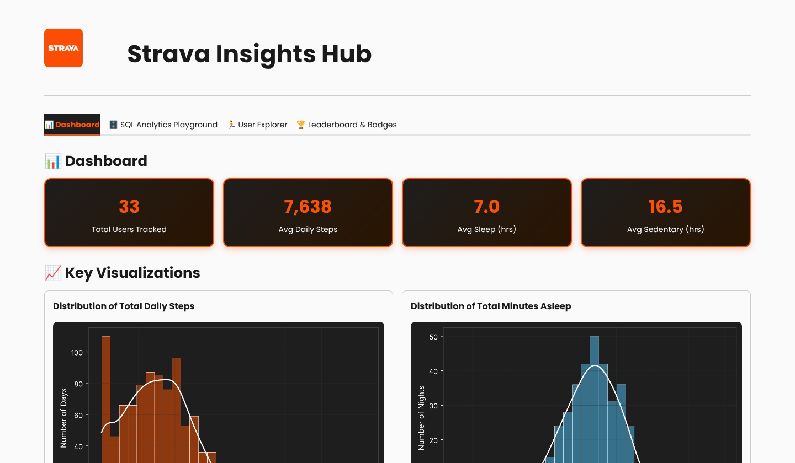

# Strava Insights Hub — Fitness Analytics

**Live app:** https://strava-fitness-analysis.streamlit.app/

A fitness analytics case study and interactive Streamlit app. It studies how users' daily activity, sleep and body measurements relate to each other, and turns that into recommendations for a fitness app.

Project 4 of 8 · Built during my Data Analyst Internship at Labmentix (Aug–Nov 2026).




## The business question

Fitness apps collect a lot of data, but it is only useful when it becomes clear advice. How do users' activity, sleep and weight relate, and what should a fitness app do about it?

The data is the public FitBit Fitness Tracker dataset (33 users, April–May 2016). It is used as a stand-in for Strava-style user behaviour.

## Key findings

- **Sitting dominates the day.** Users spend **991 minutes (16.5 hours)** sedentary per day. That is about 81% of the tracked day. Very active and fairly active time together is only 35 minutes, under 3%.
- **Most days fall short of 10,000 steps.** The average is **7,638 steps**. Only about 25% of days reach 10,000.
- **Sitting, not exercise, is linked to sleep.** Active minutes have almost no link to sleep (r = −0.069). Sedentary minutes have a clear negative link (r = **−0.60**): more sitting goes with less sleep.
- **Steps and calories are only moderately linked** (r = 0.592). Body metabolism and workout intensity also matter.
- **Weekdays and weekends look the same:** 7,669 vs 7,551 steps.
- **Non-wear days still carry information.** The 77 zero-step days still show 1,657 calories of resting burn, so they were kept and flagged, not deleted.

## Recommendations

1. **Target sitting time, not just workouts.** For example, use hourly "stand up and move" reminders.
2. **Change the sleep message** to "move more during the day to sleep better", not "work out harder".
3. **Use one daily nudge strategy.** Separate weekday and weekend campaigns aren't needed.
4. **Treat skipped tracking days as an early warning** that a user is losing interest, and send a re-engagement prompt.
5. **Keep weight features personal and opt-in.** Only 8 users logged weight, so there's no fair "compare with others" baseline.

## How it works

1. **Clean the data** (`clean_data.py` and the notebook):
   - Converted text dates to real dates and removed 3 duplicate sleep rows.
   - Kept the 77 zero-step days, flagged them as non-wear days, and left them out of "active day" averages only.
   - Kept outliers (very high-step days, naps) because they are real behaviour, not errors.
2. **Explore with 13 charts**, each with an insight, plus a heart-rate stretch analysis.
3. **Merge** activity (940 days), sleep (410 matched days) and weight (67 records) into one master table.
4. **Build the Streamlit app** with four tabs:

| Tab | What it does |
|---|---|
| 📊 Dashboard | KPI cards and the key charts |
| 🗄️ SQL Analytics Playground | Run ready-made or your own SQL queries on the data |
| 🏃 User Explorer | Pick one user and see their activity, sleep and weight |
| 🏆 Leaderboard & Badges | Rank users and award activity badges |

## Limitations

- **Small, old sample.** There are 33 users over one month in 2016. Sleep covers 24 users, weight covers only **8**, and heart rate covers 14.
- **One person skews the weight data.** One user with a BMI of about 47.5 turns a weak steps–BMI link (r = −0.21) into a strong-looking one (r = −0.74).
- **The heart-rate measure is a full-day average**, including exercise. It is not true resting heart rate, so that result is not reliable.
- **A stand-in dataset.** This is FitBit data, not Strava data. The project is not linked to Strava or Fitbit.
- **Correlation, not cause.**

## Run it locally

```bash
git clone https://github.com/Vipsa2207/Strava-Fitness-Analytics.git
cd Strava-Fitness-Analytics
pip install -r requirements.txt
streamlit run app.py
```

Run it from the repo folder so the app can find the CSV files and the logo.

## Project files

| File | What it is |
|---|---|
| `Strava_Fitness_Analytics.ipynb` | Full analysis: cleaning, 13 charts with insights, findings, recommendations and the heart-rate analysis |
| `app.py` | The Streamlit app |
| `clean_data.py` | Script that cleans the 3 raw files |
| `dailyActivity_merged.csv`, `sleepDay_merged.csv`, `weightLogInfo_merged.csv` | Raw data |
| `daily_clean.csv`, `sleep_clean.csv`, `weight_clean.csv`, `master_clean.csv` | Cleaned data and the merged master table |
| `requirements.txt` | Python libraries |

## Data source

FitBit Fitness Tracker Data (public dataset on Kaggle).

## How I built it

I used AI to help write the Python code. I framed the business question, made the cleaning decisions, checked every figure against the data, and wrote the findings.

## Author

**Vipsa Patel** — Data Analyst Intern, Labmentix · [LinkedIn](https://www.linkedin.com/in/vipsapatel)
